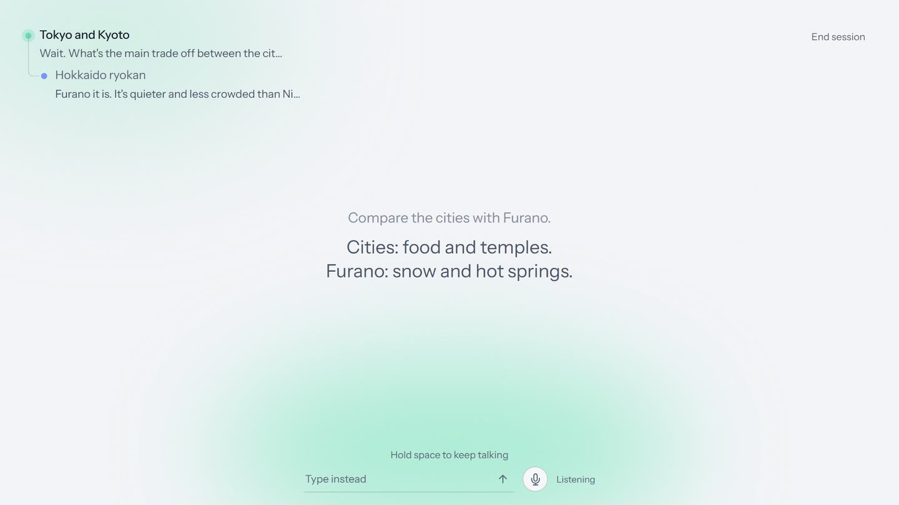
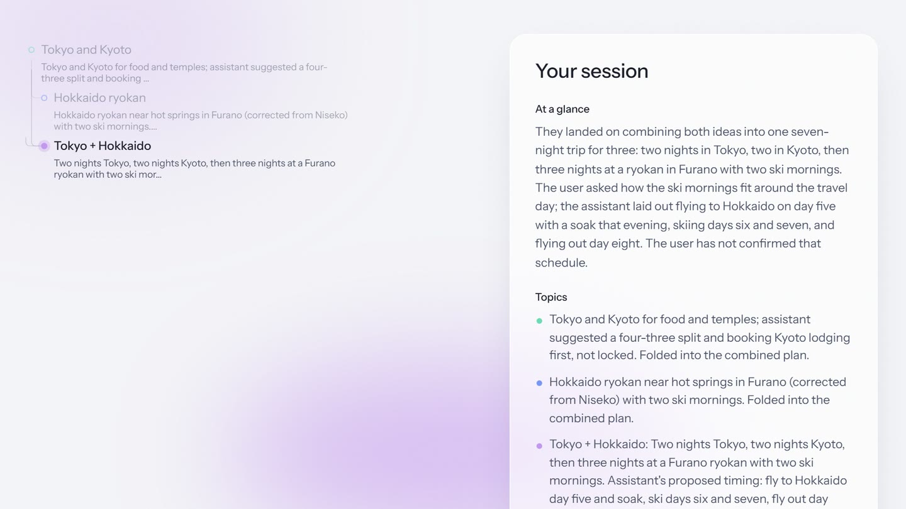

# Branch Voice

Branch Voice is a voice-first scratchpad for thinking through several ideas in one conversation. Explore an alternative out loud, return to an earlier thread by name or description, then compare or combine the two. The branch map keeps the paths visible while you talk, and End session turns the conversation into a map and downloadable Markdown notes.



## What the demo shows

A seven-night Japan itinerary starts in Tokyo and Kyoto. Hokkaido opens a second thread. Changing Niseko to Furano updates that thread as a correction. The speaker returns to the city plan, compares it with Furano and combines the two. The final report carries the correction into the combined plan. The 78-second edit replays a recorded voice session and includes a separate staged mobile-web interaction. [Demo walkthrough and credits](docs/demo-script.md)



## Run locally

Use Node.js 22 or newer. From the repository root:

```sh
npm ci
npm test
npm run typecheck
```

**Typed mode.** Copy [`.env.example`](.env.example) to `.env`, set `ANTHROPIC_API_KEY` for Claude replies and `TYPESAFE_API_KEY` for branching decisions, then run `npm start`. Open [localhost:3000](http://localhost:3000/) and choose **Type instead**. The server and tests can run without credentials. With Jev disabled, utterances continue the current thread.

**Voice mode.** Install `cloudflared` and add your Vapi public key, private key and a generated custom LLM secret to `.env`. Run `npm run live`, open the printed localhost URL, choose **Start talking** and allow microphone access. The launcher opens a temporary HTTPS tunnel, syncs the Vapi assistant and saves the tunnel URL and assistant ID locally. [Environment variables, manual setup and troubleshooting](docs/setup.md)

## Engineering

- **History follows the active branch.** A reply sees shared ancestry up to each fork point and the active branch’s turns. Corrections carry the earlier context forward and fold into the same topic in the report. [Branch history ADR](docs/adr/0001-branch-scoped-history.md)
- **Routing starts during speech.** Jev scores intent and branch targets. Stable partial transcripts can route against a session snapshot. The final turn can reuse a completed decision for matching text and revision. [Routing ADR](docs/adr/0002-routing-and-speculation.md)
- **Voice turns account for what played.** Vapi and Deepgram handle the audio. Claude streams replies through the custom LLM endpoint, and the turn pipeline uses playback evidence to trim or roll back interrupted work. [Voice turn ADR](docs/adr/0003-voice-turn-handling.md)

The recorded router evaluation got **50 of 54** held-out operations right, with **0 false forks among 7 predicted forks**. This was a development evaluation on a small split. A cached rerun reproduces the counts. The voice latency procedure tracks server emission and playback evidence separately. [Router report](docs/results/router-eval.md) · [Voice latency measurement](docs/results/latency.md)

[Architecture and repository map](docs/architecture.md) · [Architecture decisions](docs/adr/README.md)

Sessions are English-language and in memory. Idle sessions expire after 30 minutes, ended sessions and their share links after 24 hours, and a server restart clears them.
