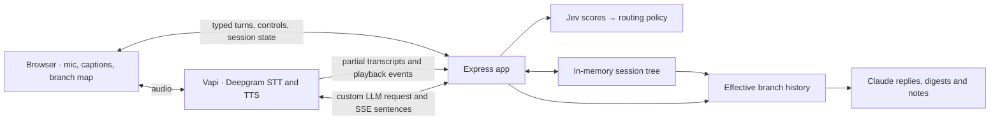

# Architecture

A single Express process serves the browser app, owns the session tree and handles Vapi callbacks. Typed and spoken turns use the same application pipeline.

## Turn lifecycle

1. The browser creates a session with a bearer token. In voice mode it binds the Vapi call ID to that session with the token.
2. An authenticated Vapi transcript webhook can start speculative routing on a stable partial. A typed turn or bound custom LLM request selects a route under the session lock.
3. The turn pipeline applies the selected operation. Claude receives the resulting branch’s effective context. Compare and merge can explicitly incorporate digests from other branches.
4. The browser polls session state to update the map. Voice answers stream complete sentences to Vapi. Playback evidence helps reconcile interruptions and keeps unheard text out of the conversation where the provider supplies evidence.
5. End session freezes the session and creates the map and notes. The authenticated session can download Markdown. The ended view can also be opened via its share link while the session is retained.

## Repository map

| Path | Role |
| --- | --- |
| [`public/`](../public/) | Browser app, Vapi SDK integration, transcript, branch map and report. |
| [`src/server.ts`](../src/server.ts) | Session API, locking, sharing and dependency wiring. |
| [`src/tree/`](../src/tree/) | Branch state, retention and effective history. |
| [`src/route/`](../src/route/) | Jev input, deterministic policy and partial-transcript cache. |
| [`src/turn/`](../src/turn/) and [`src/reply/`](../src/reply/) | Apply operations, stream replies, derive branch digests and generate notes. |
| [`src/vapi/`](../src/vapi/) | Assistant configuration, webhook and custom LLM adapters, spoken-text reconciliation. |
| [`test/`](../test/) and [`eval/router/`](../eval/router/) | Regression tests, labelled routing items and cached model scores. |
| [`film/`](../film/) | Remotion source and replay fixtures. See the [recording and replay guide](launch/recording-checklist.md). |

[Architecture decisions](adr/README.md) · [Router evaluation](results/router-eval.md) · [Latency measurement](results/latency.md)
